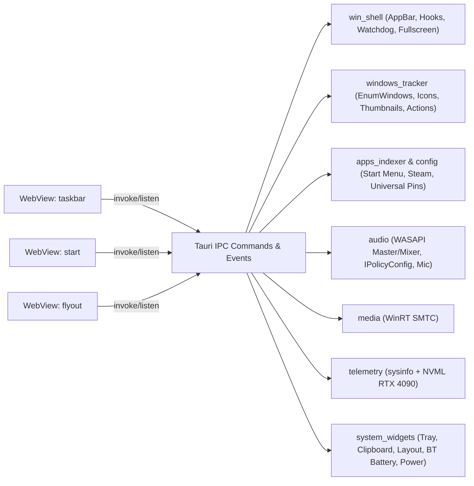

# Architecture Spine — TestBar

## Design Paradigm

**Multi-Window Native Shell / Reactive Renderer** built on **Tauri v2 (Rust + Win32/COM/WinRT)** + **React 19 / TypeScript / Vite (WebView2)**.

- **Rust Core (`src-tauri/src/`)** owns all OS integration, window lifecycle, AppBar reservation, native taskbar hiding + watchdog restoration, global hooks, WASAPI audio, SMTC media, NVML/sysinfo telemetry, clipboard listener, app/Steam indexing, and `%APPDATA%\TestBar\config.json` persistence.
- **Shared React Renderer (`src/`)** serves three pre-warmed transparent borderless WebView2 windows from a single Vite bundle routed by query string (`?view=taskbar`, `?view=start`, `?view=flyout`), communicating strictly via typed Tauri IPC commands and push events.

## Invariants & Rules



### AD-1 — Three Pre-Warmed Transparent Borderless Windows [ADOPTED]
- **Binds:** R1, R2, R4, R5, R8
- **Prevents:** Full-screen transparent overlay stealing clicks from desktop icons, cold-start lag (> 50ms) when pressing `Win`, and z-order conflicts between hover previews, context menus, and the taskbar.
- **Rule:** Spawn exactly 3 transparent frameless `skipTaskbar` topmost WebView2 windows at startup:
  1. `taskbar`: `WS_EX_TOOLWINDOW | WS_EX_NOACTIVATE | WS_EX_TOPMOST`, dynamically sized and horizontally centered to fit the floating dock pill (or full primary monitor width in Edge mode), positioned at bottom of primary monitor.
  2. `start`: `WS_EX_TOOLWINDOW | WS_EX_TOPMOST`, `1060×640` logical px centered above taskbar, pre-warmed and hidden until opened; receives focus on open so type-anywhere search drops zero characters; auto-hides on `Esc` or focus loss.
  3. `flyout`: `WS_EX_TOOLWINDOW | WS_EX_TOPMOST`, dynamically sized & positioned above the anchor button/cursor for Hover Window Preview (`SW_SHOWNOACTIVATE`), Compact 40-Icon Tray (`^`), Quick Sound & Mixer, Calendar, and Right-Click Context Menus.

### AD-2 — Zero `explorer.exe` DLL Injection + Watchdog Restore Guarantee [ADOPTED]
- **Binds:** R1, R8
- **Prevents:** Explorer instability or permanently vanished Windows taskbar after a crash or forced kill.
- **Rule:** Native taskbar hiding uses `ShowWindow(Shell_TrayWnd / Shell_SecondaryTrayWnd, SW_HIDE)` only. On startup (unless `--no-hide-native` is passed), `testbar.exe` spawns a companion self-process `testbar.exe --watchdog <pid>` waiting on parent PID via `WaitForSingleObject`; on any parent termination, panic, exit, or global hotkey `Ctrl+Alt+Shift+Esc`, native taskbars are immediately restored (`SW_SHOW`) and AppBar removed (`ABM_REMOVE`).

### AD-3 — Lone `Win` Key Hook Preserving OS Shortcuts [ADOPTED]
- **Binds:** R5, R6
- **Prevents:** Breaking `Win+E`, `Win+D`, `Win+R`, `Win+L`, `Win+V`, `Win+Shift+S`, `Win+Tab`, or window snapping.
- **Rule:** `WH_KEYBOARD_LL` suppresses and toggles TestBar Start Menu ONLY when `VK_LWIN`/`VK_RWIN` is pressed and released with zero intervening non-Win keystrokes; any combo immediately forwards unmodified to Windows.

### AD-4 — Single Persistent Config Authority & Universal Pin Schema
- **Binds:** R2, R5, R7
- **Prevents:** Desynchronized state between `taskbar`, `start`, and `flyout` windows.
- **Rule:** Rust owns `%APPDATA%\TestBar\config.json` behind a mutex; every mutation persists atomically and broadcasts `config-updated` to all 3 windows. Pinned items share one polymorphic `PinItem` schema (`kind: "app" | "folder" | "file" | "url" | "combo"`).

### AD-5 — Dynamic Library / Graceful Hardware Probing
- **Binds:** R4, R7
- **Prevents:** Startup failure or runtime panics when optional hardware APIs (NVML, Bluetooth battery, SMTC session) are absent or idle.
- **Rule:** Load `nvml.dll` dynamically via Win32 `LoadLibraryW` (no CUDA SDK link dependency). Every telemetry, audio, SMTC, and Bluetooth query returns structured fallback data instead of panicking or blocking the UI thread.

## Consistency Conventions

| Concern | Convention |
| --- | --- |
| IPC commands | `snake_case` Rust `#[tauri::command]`, invoked via typed wrapper in `src/lib/ipc.ts` |
| Push events | `kebab-case` (`windows-updated`, `audio-updated`, `media-updated`, `telemetry-updated`, `clipboard-updated`, `config-updated`, `flyout-show`, `flyout-hide`, `start-toggle`) |
| Paths & persistence | `%APPDATA%\TestBar\config.json`, icons cached in-memory as `data:image/png;base64,...` |
| Styling | Exact dark-only Obsidian Layered Glass tokens from `ux-testbar/DESIGN.md`, inline 1.5–1.9px SVG icons, zero emoji |

## Stack

| Name | Version |
| --- | --- |
| Rust / Cargo (MSVC) | 1.98.1 |
| Tauri | 2.x |
| `windows` crate | 0.58 |
| `sysinfo` | 0.33 |
| React + TypeScript | 19.x / 5.x |
| Vite | 6.x |
| Node / pnpm | 24.16 / latest |

## Structural Seed

```text
c:\Users\loki2\Documents\testbar\
  package.json
  vite.config.ts
  index.html
  src/
    main.tsx                # Routes ?view=taskbar | start | flyout
    styles/tokens.css       # Approved Obsidian Layered Glass design tokens & animations
    lib/ipc.ts              # Typed Tauri invoke/listen bridge + dev fallback
    lib/layoutMap.ts        # RU<->EN wrong keyboard layout fuzzy matcher
    components/
      Icons.tsx             # Unified crisp SVG icon set
      TaskbarView.tsx       # Bottom dock/bar, hover trigger, tray/lang/sound/clock
      StartView.tsx         # 4 adaptive Spaces, edit mode, universal pinning, type-anywhere search
      FlyoutView.tsx        # Compact 40-icon tray (^), Quick Sound & Mixer, Calendar, Window Previews, Context Menus
  src-tauri/
    Cargo.toml
    tauri.conf.json
    capabilities/default.json
    src/
      main.rs               # Watchdog entry + Tauri launch
      lib.rs                # App setup, 3-window coordinator, IPC registration
      config.rs             # Atomic %APPDATA%\TestBar\config.json & Universal Pin schema
      win_shell.rs          # AppBar, safe native taskbar hide/restore, WH_KEYBOARD_LL, fullscreen detect, emergency hotkey
      windows_tracker.rs    # EnumWindows, HICON->PNG extraction, PrintWindow thumbnails, focus/minimize/close/kill/admin
      apps_indexer.rs       # Start Menu .lnk scanner, Steam library + hero cover loader, native file/folder picker, launcher
      audio.rs              # WASAPI master/per-app mixer, IPolicyConfig device switch, mic mute
      media.rs              # WinRT SMTC Now Playing & transport controls
      telemetry.rs          # sysinfo CPU/RAM/top processes + dynamic nvml.dll RTX 4090 GPU/VRAM/temp
      system_widgets.rs     # Compact tray background apps, clipboard history listener, keyboard layout, BT battery, network, power
```

## Capability → Architecture Map

| Capability | Lives in | Governed by |
| --- | --- | --- |
| R1 (AppBar & Safe Hide/Watchdog) | `src-tauri/src/win_shell.rs`, `main.rs` | AD-1, AD-2 |
| R2 (Taskbar, Live Previews, Context Menu) | `windows_tracker.rs`, `TaskbarView.tsx`, `FlyoutView.tsx` | AD-1, AD-4 |
| R3 (Fullscreen Auto-Hide) | `win_shell.rs` | AD-1 |
| R4 (40-Icon Tray, Sound/Mixer, Layout, Calendar) | `audio.rs`, `system_widgets.rs`, `FlyoutView.tsx` | AD-1, AD-5 |
| R5 (4 Spaces, Edit Mode, Universal Pinning) | `config.rs`, `apps_indexer.rs`, `StartView.tsx` | AD-1, AD-3, AD-4 |
| R6 (Type-Anywhere RU↔EN Search) | `StartView.tsx`, `layoutMap.ts`, `apps_indexer.rs` | AD-1, AD-3 |
| R7 (SMTC, Clipboard, Telemetry, Steam, Peripherals) | `media.rs`, `telemetry.rs`, `system_widgets.rs`, `apps_indexer.rs` | AD-5 |
| R8 (Standalone `.exe` Build) | `src-tauri/Cargo.toml`, `tauri.conf.json`, Vite | AD-1, AD-2 |
