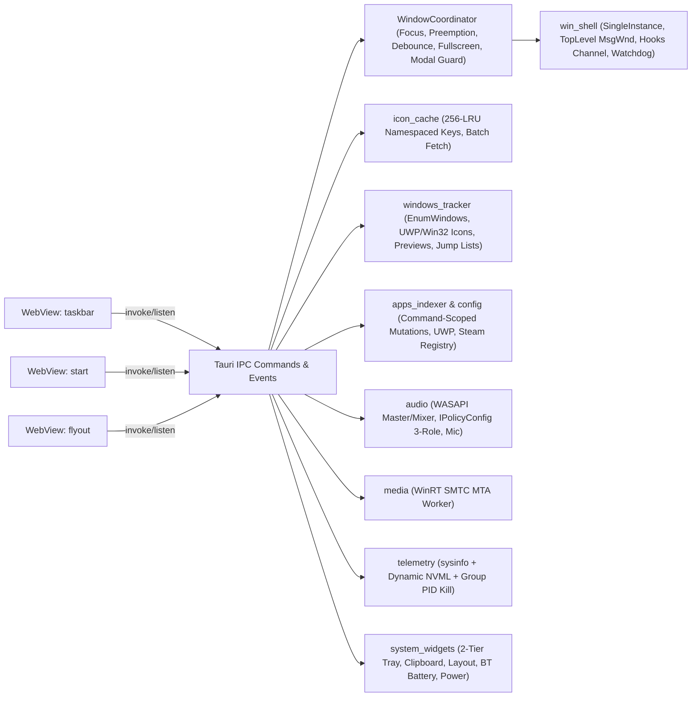

# Architecture Spine — TestBar

## Design Paradigm

**Multi-Window Native Shell / Reactive Renderer** built on **Tauri v2 (Rust + Win32/COM/WinRT)** + **React 19 / TypeScript / Vite (WebView2)**.

- **Rust Core (`src-tauri/src/`)** owns all OS integration, a single `WindowCoordinator` for window lifecycle/focus/fullscreen/debounce state, a single `IconCache` service, a hidden top-level `WS_OVERLAPPED` AppBar & `TaskbarCreated` message window, native taskbar hiding + watchdog restoration, non-blocking global hooks, WASAPI audio, WinRT SMTC media, NVML/sysinfo telemetry, clipboard listener, app/UWP/Steam indexing, and `%APPDATA%\TestBar\config.json` persistence.
- **Shared React Renderer (`src/`)** serves three pre-warmed transparent borderless WebView2 windows from one Vite bundle routed by query string (`?view=taskbar`, `?view=start`, `?view=flyout`), communicating strictly via typed Tauri IPC commands and targeted push events.

## Invariants & Rules



### AD-1 — Three Pre-Warmed Non-Resizable Windows Under One Coordinator [ADOPTED]
- **Binds:** R1, R2, R3, R4, R5, R8
- **Prevents:** `WS_THICKFRAME` border artifacts on Win11 transparent windows, WebView2 DOM thrashing from `1×1` window shrinking, hover previews clobbering click flyouts, volume OSD shifting taskbar width, double-toggle focus races, and modal file-picker dismissing Start Menu.
- **Rule:** Spawn exactly 3 pre-warmed transparent frameless `skipTaskbar` topmost WebView2 windows (`resizable: false`, `decorations: false`, `shadow: false`, `transparent: true`):
  1. `taskbar`: `WS_EX_TOOLWINDOW | WS_EX_NOACTIVATE | WS_EX_TOPMOST`, positioned at primary monitor bottom (centered Dock capsule or full-width Edge bar); bounds updates MUST NEVER force visibility while fullscreen-suppressed.
  2. `start`: `WS_EX_TOOLWINDOW | WS_EX_TOPMOST`, fixed logical bounds matching `DESIGN.md` chassis + shadow padding, centered above taskbar; shown/hidden strictly via visibility (`SW_SHOW` / `SW_HIDE`, never `1×1` shrink); acquires foreground focus via coordinator helper; focus-loss auto-hide is suppressed while a native modal picker (`rfd`) is active.
  3. `flyout`: `WS_EX_TOOLWINDOW | WS_EX_TOPMOST`, governed by closed enum `FlyoutKind = preview | tray | sound | calendar | context_app | context_bar | osd`.
     - **Preemption:** Interactive click flyouts (`tray`, `sound`, `calendar`, `context_*`) MUST NOT be overwritten by hover `preview` or transient `osd` (when `sound` is already open, wheel scroll updates it in place instead of replacing it with `osd`).
     - **Volume OSD:** Scroll-wheel volume feedback renders via non-activating `FlyoutKind::Osd` anchored above the sound pill so `taskbar` bounds never resize or jitter on wheel scroll.
     - **Non-Activating Mode:** Subclassed `flyout` `WndProc` returns `MA_NOACTIVATE` on `WM_MOUSEACTIVATE` whenever active mode is `preview` or `osd` (never toggling `GWL_EXSTYLE` + `SWP_FRAMECHANGED` per open).
     - **Anchor & Gap Contract:** Frontends pass window-local logical anchor rects + desired flyout size; Rust `WindowCoordinator` converts to physical screen coordinates using `GetDpiForWindow` / primary monitor rect, clamps on-screen, positions `preview` flush (gapless hover bridge) and click flyouts at `10–12px` above taskbar.
  4. **Click-Outside & Anti-Double-Toggle:** `WH_MOUSE_LL` enqueues `GlobalMouseDown(x, y)` (physical screen px); `WindowCoordinator` dismisses open `start`/`flyout` when `(x, y)` lies outside all active shell window rects and applies a `180ms` debounce per trigger (`start`, `flyout:<kind>`) after dismissal to prevent click-to-close from immediately re-opening.

### AD-2 — Zero `explorer.exe` DLL Injection + Single-Instance + Top-Level AppBar/Watchdog [ADOPTED]
- **Binds:** R1, R8
- **Prevents:** Duplicate instances corrupting saved work area, Explorer crashes, missed `TaskbarCreated` broadcasts on `HWND_MESSAGE`, corrupted HiDPI work areas (hardcoded `bottom - 48`), and orphaned AppBars after crashes.
- **Rule:**
  1. Acquire named Win32 single-instance mutex (`Local\TestBar_SingleInstance_v1`) before touching native taskbars or capturing work area; a second launch exits cleanly without mutating shell state.
  2. Native taskbar hiding uses `ShowWindow(Shell_TrayWnd / Shell_SecondaryTrayWnd, SW_HIDE)` only (zero DLL injection, zero `ReadProcessMemory` on `explorer.exe`).
  3. Before hiding or registering AppBar, capture original primary monitor `RECT` and `SPI_GETWORKAREA` and persist them to `%LOCALAPPDATA%\TestBar\recovery-workarea.json`.
  4. Own one hidden **top-level `WS_OVERLAPPED` message window** (NEVER `HWND_MESSAGE`, which cannot receive broadcast messages) that registers the bottom AppBar (`SHAppBarMessage`, `uCallbackMessage = WM_APP + 10`) with DPI-scaled logical height (`64px` in Dock mode = `52px` bar + `12px` margin; `52px` in Edge mode) and handles `ABN_POSCHANGED`, `ABN_FULLSCREENAPP`, `RegisterWindowMessageW("TaskbarCreated")`, `WM_DISPLAYCHANGE`, and `WM_DPICHANGED`.
  5. On startup (unless `--no-hide-native`), spawn `testbar.exe --watchdog <pid> --workarea <l,t,r,b>` waiting on parent PID via `WaitForSingleObject`; on parent exit/crash, Rust panic hook, or global hotkey `Ctrl+Alt+Shift+Esc`, unregister AppBar (in-process `ABM_REMOVE`; in watchdog via local dummy-HWND `ABM_NEW` + `ABM_REMOVE` flush), show `Shell_TrayWnd` / `Shell_SecondaryTrayWnd` (`SW_SHOW`), and restore the captured HiDPI `SPI_SETWORKAREA` (`SPIF_SENDCHANGE`).

### AD-3 — Non-Blocking Global Hooks via Bounded Channel [ADOPTED]
- **Binds:** R5, R6
- **Prevents:** Windows `LowLevelHooksTimeout` silently removing keyboard/mouse hooks, input stutter, and broken OS `Win+<key>` shortcuts (`Win+E/D/R/L/V/Shift+S/Tab`).
- **Rule:** `WH_KEYBOARD_LL` and `WH_MOUSE_LL` callbacks MUST perform zero Tauri IPC, zero `SetWindowPos`/`ShowWindow`, and zero blocking I/O on the hook thread. They only inspect key/mouse state and enqueue compact `ShellHookEvent` values via non-blocking `try_send` on a bounded channel (`capacity = 64`) drained by a dedicated coordinator worker thread. Lone `VK_LWIN`/`VK_RWIN` down+up with zero intervening non-Win keys suppresses Windows Start and toggles TestBar Start; any chord forwards unmodified.

### AD-4 — Single Persistent Config Authority & Command-Scoped Mutations [ADOPTED]
- **Binds:** R2, R5, R7
- **Prevents:** Lost-update races between `taskbar` and `start` overwriting each other's config changes, duplicate pinned+running taskbar icons, clipped user pins, or corrupted config files on kill.
- **Rule:**
  1. Rust owns `%APPDATA%\TestBar\config.json` (`schema_version: u32 = 1`) behind a mutex; every write is atomic (`tmp` + `rename`) and increments monotonic `revision: u64` broadcast in `config-updated`.
  2. Frontends MUST NEVER invoke a full-document `save_config` overwrite; all edits go through command-scoped IPC mutations (`pin_item`, `unpin_item`, `reorder_pins`, `set_layout_mode`, `set_autostart`, `create_custom_space`, `toggle_clipboard_pin`, etc.).
  3. All pinned items share one polymorphic `PinItem` schema (`id`, `kind: "app" | "folder" | "file" | "url" | "combo"`, `title`, `target`, `args`, `match_exe`, `match_aumid`, `combo_targets: Option<Vec<String>>`), enabling exact pinned-to-running taskbar deduplication across Win32 and UWP apps.
  4. All Space lists support uniform drag-and-drop reorder and unlimited user pins (UI wraps/scrolls rather than `.slice()`-dropping pins beyond fixed counts). Pinned clipboard items persist in `config.pinned_clipboard`.

### AD-5 — Dynamic Library & Graceful Hardware/COM Probing [ADOPTED]
- **Binds:** R4, R7
- **Prevents:** Startup failures, COM apartment corruption (`CoUninitialize` mismatches), UI stalls on WinRT calls, or silent error swallowing on audio switching / process kills.
- **Rule:**
  1. Load `nvml.dll` dynamically via Win32 `LoadLibraryW` (no CUDA SDK link dependency).
  2. Every COM/WinRT subsystem (`audio`, `media`, `apps_indexer`, `windows_tracker`) uses an RAII COM guard honoring the actual `CoInitializeEx` `HRESULT` (never calling `CoUninitialize` when `RPC_E_CHANGED_MODE` was returned), and WinRT SMTC runs on a dedicated MTA worker thread with zero `thread::sleep` inside IPC commands.
  3. `IPolicyConfig` output switching sets all three roles (`eConsole`, `eMultimedia`, `eCommunications`) and propagates `HRESULT` errors; hardware probes return structured fallback payloads rather than panicking; destructive actions (process kill, admin launch) propagate real OS error messages to the UI.

### AD-6 — Unified `IconCache`, Targeted Diff-Only IPC, Hydration & Single Fullscreen Authority
- **Binds:** R2, R3, R4, R8
- **Prevents:** Idle CPU/memory bloat from pushing base64 PNGs to hidden windows every `650ms`, stale state when opening hidden windows, lost clipboard history while Start is closed, and taskbar flicker from dual fullscreen detectors.
- **Rule:**
  1. One Rust `IconCache` service owns icon extraction and LRU caching (`max = 256` entries) under namespaced keys (`exe:<hash>`, `aumid:<hash>`, `hwnd:<hwnd>:<rev>`, `file:<hash>`). Window/app/tray IPC payloads carry `icon_key` only; views fetch missing PNG data URIs in batches via `get_icons(keys: Vec<String>)` and cache them in a local `Map`.
  2. Background collectors (`AddClipboardFormatListener`, window tracker) remain active continuously; only IPC *emission* is suppressed for hidden windows. Whenever `WindowCoordinator` transitions `start` or `flyout` from hidden → visible, it immediately pushes a fresh hydration snapshot (`start-state`, `flyout-show` payload) to that window.
  3. Audio events split into lightweight `audio-master-updated` (master volume/mute/default device -> `taskbar` + visible views) and `audio-mixer-updated` (filtered active per-app sessions -> only when `start` or `flyout(sound)` is visible).
  4. **Single Fullscreen Authority:** `classify_fullscreen()` in `coordinator.rs` is the sole authority for fullscreen suppression. `ABN_FULLSCREENAPP` from the AppBar window acts solely as an immediate trigger to re-evaluate `classify_fullscreen()`, which returns `true` ONLY for `QUNS_RUNNING_D3D_FULL_SCREEN` / `QUNS_PRESENTATION_MODE` or a non-shell, non-TestBar window covering the full primary monitor without `WS_CAPTION` and `WS_THICKFRAME` (excluding `Progman`/`WorkerW` and normal maximized windows).

### AD-7 — Win11 24H2-Compatible OS Integrations, Security & Pure-Core Testability
- **Binds:** R1, R2, R4, R6, R7, R8
- **Prevents:** Untestable Win32 monoliths, broken UWP icons, C1-violating `explorer.exe` scraping on Win11 24H2 XAML tray, impossible MSIX-only APIs in a portable `.exe`, and wide-open WebView2 CSP.
- **Rule:**
  1. Pure logic (`coordinator.rs`, fullscreen classifier, AppBar DPI rect calculator, config schema/CRUD/reorder, process-group aggregator, `layoutMap.ts`, search ranker) lives in Win32-independent modules verified by `cargo test` and `pnpm test` (Vitest, added in Epic 1 Story 1.1).
  2. **UWP Icons:** `ApplicationFrameHost.exe` windows resolve real packaged app identity via child `Windows.UI.Core.CoreWindow` PID -> `GetApplicationUserModelId` (`Win32_Storage_Packaging_Appx`) -> `IShellItemImageFactory` before falling back to exe icons.
  3. **Process Termination & Shell Launch:** Group process termination kills all PIDs in the target process group (single-window End Task kills that window's PID); `explorer.exe /select` uses unescaped raw args (`raw_arg`); Steam path reads `HKCU\Software\Valve\Steam\SteamPath` (`Win32_System_Registry`) with fallback.
  4. **Two-Tier Tray Overflow (`^`) on Win11 24H2/25H2:** Because Windows 11 24H2 replaced `ToolbarWindow32` with XAML Islands (`TopLevelWindowForOverflowXamlIsland`) inaccessible while `Shell_TrayWnd` is hidden without violating C1, TestBar provides: (a) a real 6-column grid of active background user apps owning hidden/tray-capable windows (restoring/activating their real hidden window on click instead of spawning duplicates, plus Open / Location / End Task on right-click), and (b) a 1-click header trigger to briefly invoke native Windows overflow (`Win+B`) for proprietary tray-only menus.
  5. **Calendar Notifications in Portable `.exe` (C3):** Because WinRT `UserNotificationListener` requires MSIX Package Identity (`APPMODEL_ERROR_NO_PACKAGE` on portable `.exe`), Calendar displays TestBar local session alerts + a 1-click button invoking the native Windows 11 Notification Center (`Win+N`).
  6. **Security & Build Config:** `tauri.conf.json` enforces explicit local CSP (`default-src 'self'; img-src 'self' data:; style-src 'self' 'unsafe-inline'`) and disables unnecessary bundler targets when building local standalone `testbar.exe`.

## Consistency Conventions

| Concern | Convention |
| --- | --- |
| IPC commands | `snake_case` Rust `#[tauri::command]`, invoked via typed wrapper in `src/lib/ipc.ts` (with dev-mode mock fallback outside Tauri) |
| Push events | `kebab-case` (`windows-updated`, `audio-master-updated`, `audio-mixer-updated`, `media-updated`, `telemetry-updated`, `clipboard-updated`, `config-updated`, `flyout-show`, `flyout-hide`, `start-state`) |
| Paths & persistence | `%APPDATA%\TestBar\config.json` (atomic tmp+rename, `schema_version`, `revision`); `%LOCALAPPDATA%\TestBar\recovery-workarea.json` |
| Icon delivery | Namespaced `icon_key` in Rust `IconCache` (256 LRU), fetched lazily in batches via `get_icons(keys)` |
| Styling & UX | Exact dark-only Obsidian Layered Glass tokens from `ux-testbar/DESIGN.md`, crisp 1.5–1.9px inline SVG icons, zero emoji, zero tutorial hints |
| Operational envelope | Local single-user Windows 11 desktop `.exe`, single-instance mutex, zero cloud services, zero outbound telemetry, HKCU autostart |
| Verification | `pnpm build` (tsc + Vite), `pnpm test` (Vitest), `cargo test --manifest-path src-tauri/Cargo.toml`, and `pnpm tauri build` |

## Stack

| Name | Version |
| --- | --- |
| Rust / Cargo (MSVC) | 1.98.1 |
| Tauri (`tauri` / `@tauri-apps/api`) | 2.12.7 / ^2.2.0 |
| `windows` crate | 0.58 (+ `Win32_Storage_Packaging_Appx`, `Win32_System_Registry`) |
| `sysinfo` | 0.33 |
| React + TypeScript | 19.3.1 / 5.9.3 |
| Vite + Vitest | 6.4.6 / Vitest (added in Epic 1 Story 1.1) |
| Node / pnpm | 24.16 / latest |

## Structural Seed

```text
c:\Users\loki2\Documents\testbar\
  package.json
  vite.config.ts
  index.html
  src/
    main.tsx                # Routes ?view=taskbar | start | flyout
    styles/tokens.css       # Approved Obsidian Layered Glass design tokens & animations
    lib/ipc.ts              # Typed Tauri invoke/listen bridge + dev fallback + icon Map cache
    lib/layoutMap.ts        # RU<->EN wrong keyboard layout fuzzy matcher
    components/
      Icons.tsx             # Unified crisp SVG icon set (zero emoji/unicode glyphs)
      TaskbarView.tsx       # Bottom dock/bar, hover trigger, tray/lang/sound/clock (OSD delegated to flyout)
      StartView.tsx         # 4 adaptive Spaces + custom, edit mode, universal pinning, type-anywhere search
      FlyoutView.tsx        # Compact 40-icon tray (^), Quick Sound & Mixer, Volume OSD, Calendar, Window Previews, Context Menus
  src-tauri/
    Cargo.toml
    tauri.conf.json         # 3 windows with resizable: false, transparent: true, decorations: false, strict local CSP
    capabilities/default.json
    src/
      main.rs               # Watchdog entry (--watchdog <pid> --workarea <l,t,r,b>) + single-instance Tauri launch
      lib.rs                # App setup, command-scoped IPC registration, targeted diff pollers
      coordinator.rs        # Pure testable WindowCoordinator state machine (focus, preemption, debounce, fullscreen, modal guard)
      icon_cache.rs         # Unified 256-LRU namespaced IconCache + batch get_icons resolver
      config.rs             # Atomic %APPDATA%\TestBar\config.json (schema_version, revision, PinItem)
      win_shell.rs          # Single-instance mutex, top-level WS_OVERLAPPED AppBar/TaskbarCreated MsgWnd, HiDPI WorkArea save/restore, bounded hooks channel, watchdog
      windows_tracker.rs    # EnumWindows, UWP+Win32 IconCache integration, PrintWindow thumbnails, Jump Lists, focus/close/kill/admin
      apps_indexer.rs       # Start Menu .lnk + UWP AppsFolder + Steam registry scanner + user file search + rfd pickers
      audio.rs              # WASAPI master/active-session mixer, IPolicyConfig (3 roles), mic mute
      media.rs              # Dedicated MTA worker WinRT SMTC Now Playing & transport controls
      telemetry.rs          # sysinfo CPU/RAM/multi-PID process groups + dynamic nvml.dll GPU/VRAM/temp
      system_widgets.rs     # 2-tier Tray inspector, clipboard listener, keyboard layout, BT battery, network, power, Win+N/Win+B helpers
```

## Capability → Architecture Map

| Capability | Lives in | Governed by |
| --- | --- | --- |
| R1 (AppBar, Safe Hide, Watchdog, Single-Instance, Explorer Restart) | `win_shell.rs`, `coordinator.rs`, `main.rs` | AD-1, AD-2 |
| R2 (Taskbar, UWP/Win32 Icons, Previews, Context Menu, Jump Lists) | `windows_tracker.rs`, `icon_cache.rs`, `TaskbarView.tsx`, `FlyoutView.tsx` | AD-1, AD-4, AD-6, AD-7 |
| R3 (Single-Authority Strict Fullscreen Auto-Hide) | `win_shell.rs`, `coordinator.rs` | AD-1, AD-6 |
| R4 (2-Tier Tray, WASAPI Sound/Mixer, OSD Flyout, Layout, Calendar) | `audio.rs`, `system_widgets.rs`, `TaskbarView.tsx`, `FlyoutView.tsx` | AD-1, AD-5, AD-6, AD-7 |
| R5 (4 Spaces, Edit Mode, Universal Pinning, Lone Win Hook) | `config.rs`, `apps_indexer.rs`, `win_shell.rs`, `StartView.tsx` | AD-1, AD-3, AD-4 |
| R6 (Type-Anywhere RU↔EN Search across Apps/UWP/Files/Spaces) | `StartView.tsx`, `layoutMap.ts`, `apps_indexer.rs` | AD-1, AD-3, AD-7 |
| R7 (SMTC, Clipboard, Telemetry, Steam Registry, Peripherals) | `media.rs`, `telemetry.rs`, `system_widgets.rs`, `apps_indexer.rs` | AD-5, AD-6, AD-7 |
| R8 (Standalone `.exe`, Automated Tests, Autostart) | `Cargo.toml`, `tauri.conf.json`, `package.json`, `coordinator.rs` | AD-1, AD-2, AD-7 |

## Deferred

- **Multi-monitor independent taskbars** (v1.0 shows TestBar on primary monitor and hides secondary native taskbars safely; independent secondary taskbars deferred to v1.1).
- **Taskbar placement on top/left/right screen edges** (v1.0 bottom edge only).
- **Third-party plugin or custom CSS theme engine** (explicitly out of scope for v1.0).
- **Installer packaging (NSIS/WiX)** (v1.0 delivers locally built portable standalone `testbar.exe`; optional installer deferred).
- **MSIX Package Identity & WinRT `UserNotificationListener` toast interception** (deferred to a future MSIX-packaged release because Windows 11 rejects `UserNotificationListener` in unpackaged `.exe` builds; v1.0 Calendar provides local TestBar alerts plus 1-click native Windows Notification Center toggle).
